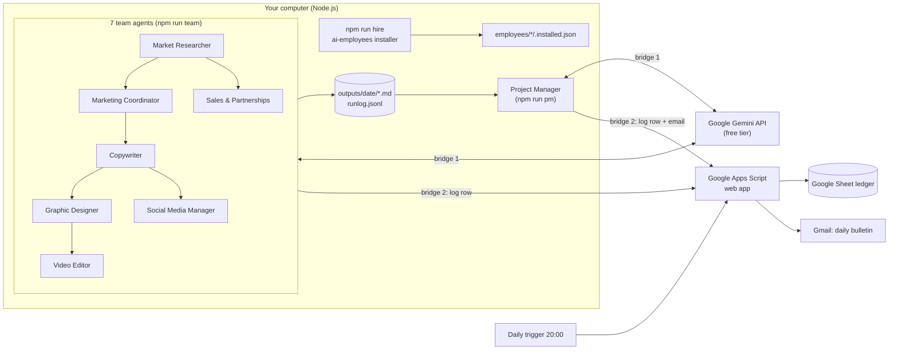

# AI Creative & Video Marketing Agency

An autonomous AI agency with **8 AI employees** built on the open source [ai-employees](https://github.com/markfulton/ai-employees) kits.
Seven employees produce a short-video marketing campaign for a client; the **Project Manager** audits their work, logs every run to a **Google Sheet ledger** and **emails a daily status bulletin**.

Demo client (fictional): **NovaBrew Coffee**, launching NovaBrew Cold Brew to students and young professionals. Change the client in `agency.config.json`.

## The team

| # | AI employee | Base kit (ai-employees) | Daily task | Output file |
|---|---|---|---|---|
| 1 | Market Researcher | `seo-employee` | Trends, competitors, target audience | `01-market-research.md` |
| 2 | Marketing Coordinator | `gtm-engineer` | Campaign plan, 7-day content calendar, KPIs | `02-campaign-plan.md` |
| 3 | Copywriter | `social-media-employee` | Video scripts, hooks, captions | `03-scripts-and-captions.md` |
| 4 | Graphic Designer | `web-dev-employee` | Design brief, AI image prompts | `04-design-brief.md` |
| 5 | Video Editor | `ad-manager-employee` | Storyboard, shot list, edit plan, AI video prompts | `05-storyboard-and-edit-plan.md` |
| 6 | Social Media Manager | `customer-satisfaction-employee` | Posting plan per platform, comment triage and reply drafts | `06-social-posting-and-replies.md` |
| 7 | Sales & Partnerships Manager | `sales-employee` | Influencer and B2B partner list, outreach template | `07-partnerships-outreach.md` |
| 8 | **Project Manager** | `chief-of-staff` | Audits all 7, updates the Google Sheet, emails the daily brief | `00-daily-brief.md` |

## Architecture



- **Bridge 1, AI:** `src/gemini.mjs` calls the free Gemini API. It picks the fastest available model, retries when a model is busy and falls back to the next model.
- **Bridge 2, Google:** `src/sheets.mjs` posts to the Apps Script web app in `apps-script/Code.gs`, which appends ledger rows and sends the email. A daily time trigger sends an evening bulletin even when the computer is off.
- **Hand-offs:** each agent reads the files its teammates wrote today (for example the Copywriter reads the Marketing Coordinator's plan).
- **Guardrails** from the base kits: drafts only, nothing is posted, sent to customers or paid without a human click.

## Setup

Requirements: Node.js 18+, a Google account, a free Gemini API key.

```bash
npm run hire          # hires the 8 employees: npx ai-employees hire <kit> --to employees/<agent>
cp .env.example .env  # then fill in GEMINI_API_KEY and SHEET_WEBHOOK_URL
npm run check         # checks Node, the key, the Apps Script bridge and the 8 receipts
```

Google Sheet bridge:
1. Create a Google Sheet, open **Extensions > Apps Script**, paste `apps-script/Code.gs`, save.
2. Run `setup` once and allow the permissions.
3. **Deploy > New deployment > Web app**, Execute as **Me**, Who has access **Anyone**. Copy the URL into `SHEET_WEBHOOK_URL`.

## Run

```bash
npm run daily                 # all 7 agents, then the Project Manager (ledger + email)
npm run agent -- copywriter   # one agent
npm run pm                    # only the Project Manager
npm run demo                  # the full pipeline without calling Gemini
```

To run it every morning, add `npm run daily` to Windows Task Scheduler (or cron on macOS/Linux).

## Repository layout

```
agency.config.json        agency, client brief and the 8 agents
apps-script/Code.gs       Google Sheets + Gmail bridge (web app + daily trigger)
setup/hire-team.mjs       hires the 8 kits with the ai-employees installer
setup/check-setup.mjs     pre-flight check
src/agents.mjs            each agent's task and prompt
src/run-agents.mjs        runs the team, writes outputs, logs to the Sheet
src/project-manager.mjs   audit, daily brief, Sheet row, email
src/gemini.mjs            bridge 1 (AI)
src/sheets.mjs            bridge 2 (Google)
employees/<agent>/        the hired kits, each with .installed.json and AGENCY-ROLE.md
employees/team.installed.json   summary of all 8 install receipts
outputs/<date>/           the agents' work and runlog.jsonl
```

## Credits

AI employee kits: [markfulton/ai-employees](https://github.com/markfulton/ai-employees) (MIT). This project is a course assignment for Programming for Data Science.
